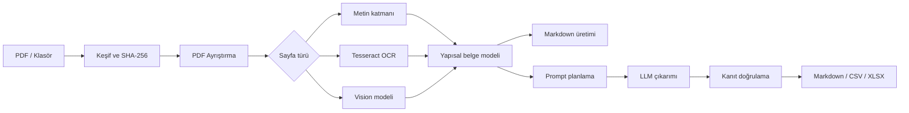

# pdf2md — Yerel Akademik PDF İşleme ve Bilgi Çıkarımı

[](LICENSE)

pdf2md, akademik PDF koleksiyonlarını yerel olarak Markdown'a dönüştüren ve isteğe
bağlı olarak kaynak gösterilebilir bilgi çıkarımı yapan açık kaynaklı bir Python
uygulamasıdır.

Bir klasördeki (veya tek bir) akademik PDF'i tamamen yerel olarak işler. İki şekilde çalışır:

- **Prompt verilmezse** her PDF için tam Markdown dönüşümü üretir. Başlıklar, tablolar, LaTeX formüller, şekil başlıkları ve kaynakça korunur.
- **Prompt verilirse** ("veri setlerini ve en iyi sonuçları çıkar", "modelleri karşılaştır") yalnızca istenen bilgiyi kanıtıyla çıkarır ve doğrular. Cevap belge başına bir `.md` dosyasına veya tüm koleksiyon için tek bir Markdown dosyasına yazılır.

Model çağrıları yalnızca yerel Ollama servisine (`127.0.0.1`) gider; PDF içeriği bilgisayardan çıkmaz. Gereksinimler için `gereksinim-analizi.md`, uygulama kararları için `fazlar/` ve `docs/gereksinim-guncellemeleri.md` dosyalarına bakın.

## Özellikler

- **PDF türleri:** metin tabanlı, taranmış (Tesseract OCR) ve karışık PDF'ler; çift sütun okuma sırası; üst/alt bilgi temizliği; başlık hiyerarşisi
- **Görsel içerik:** tablo, formül ve şekiller MiniCPM-V ile işlenir. Görselden okunan tablo sayıları metin katmanıyla karşılaştırılır.
- **Prompt planlama:** Gemma, isteği kapsam, alanlar ve çıktı başlıklarından oluşan bir plana dönüştürür. Planı `--plan-only` ile önceden görebilirsiniz.
- **Kanıt doğrulama:** her sayısal değer blok kimliği ve sayfayla kaynağa bağlanır. Doğrulanamayan değerler `[unverified]` olarak işaretlenir.
- **Koleksiyon analizi:** makaleler arası karşılaştırma yapılır; her iddiada makale ve sayfa gösterilir.
- **Envanter:** `papers_summary.csv` dosyası künye, durum, sayfa/çağrı sayıları ve isteğe bağlı analitik sütunları içerir.
- **Sağlamlık:** SHA-256 ile değişiklik tespiti ve önbellek, kesinti sonrası devam, eşzamanlı çalıştırma kilidi, atomik yazım
- **Arayüzler:** komut satırı ve basit masaüstü arayüzü (tkinter)

## Markdown ve Yapay Zeka

Markdown bu projede yalnızca son çıktı biçimi değildir; PDF içeriğinin yapısal,
taşınabilir ve yapay zeka tarafından işlenebilir ara temsilidir. Başlıklar,
tablolar, formüller ve şekiller anlamlı Markdown öğelerine dönüştürülür; sayfa
işaretleri (`<!-- page: n -->`), blok kimlikleri ve front matter kaynak izini
korur. LLM yalnızca belge bağlamından çıkarım yapar; `evidence_verifier.py`
iddiaları kaynak metinle karşılaştırır ve doğrulanamayan değerleri işaretler.

Bu nedenle Markdown; insan incelemesi, Git tabanlı sürümleme, arama ve gelecekteki
RAG/embedding iş akışları için ortak sözleşmedir.

## Sistem Mimarisi



CLI ve Tkinter GUI aynı çalışma çekirdeği olan `src/runner.py` dosyasını kullanır.
Keşif, ayrıştırma, OCR/görsel analiz, yerel Ollama istemcisi, prompt planlama,
çıkarım, kanıt doğrulama ve çıktı üretimi ayrı modüllerdedir. Durum yönetimi,
SHA-256 önbelleği, kilit ve atomik yazım kesinti sonrası devam etmeyi sağlar.

## Kurulum

Gerekenler: Python 3.11+, [Ollama](https://ollama.com) ve Tesseract OCR. GPU önerilir; ölçümler RTX 4500 Ada (24 GB) üzerinde yapıldı.

### Windows

```cmd
python -m venv .venv
.venv\Scripts\python.exe -m pip install --upgrade pip
.venv\Scripts\python.exe -m pip install -r requirements.txt
```

İsteğe bağlı paketler (XLSX envanteri, renkli konsol):

```cmd
.venv\Scripts\python.exe -m pip install -r requirements-optional.txt
```

**Tesseract:** [UB Mannheim kurulumunu](https://github.com/UB-Mannheim/tesseract/wiki) kullanın. Türkçe belgeler için kurulumda "Turkish" dil paketini seçin. `tesseract.exe` PATH'te değilse `config.yaml` içinde yolunu belirtin:

```yaml
ocr:
  tesseract_path: "C:/Program Files/Tesseract-OCR/tesseract.exe"
  languages: ["eng", "tur"]
```

**Ollama modelleri:**

```cmd
ollama pull gemma4:latest
ollama pull minicpm-v4.5:8b
```

### Linux / macOS

Bu platformlar test edilmedi; aşağıdaki komutlar gereksinim belgesindeki (§34.3) kurulum adımlarıdır.

```bash
python3 -m venv .venv
.venv/bin/python -m pip install --upgrade pip
.venv/bin/python -m pip install -r requirements.txt
# Tesseract: Debian/Ubuntu
sudo apt install tesseract-ocr tesseract-ocr-tur
# Tesseract: macOS
brew install tesseract tesseract-lang
ollama pull gemma4:latest
ollama pull minicpm-v4.5:8b
```

Uygulama genel `site-packages` kullanmaz ve sanal ortam dışında çalıştırılırsa uyarır. Başlangıç kontrolleri Python sürümünü, paketleri, Tesseract'ı, Ollama'yı, modelleri, disk alanını ve yolları işlem başlamadan denetler. Bir sorun bulunursa çözüm komutunu gösterir ve 2 koduyla çıkar.

## Hızlı Başlangıç

Tam Markdown dönüşümü:

```cmd
.venv\Scripts\python.exe process_papers.py "D:\papers"
```

Belge başına bilgi çıkarımı:

```cmd
.venv\Scripts\python.exe process_papers.py "D:\papers" --prompt "Veri setini, modelleri ve en iyi sonuçları çıkar."
```

Koleksiyon karşılaştırması (tek Markdown dosyası):

```cmd
.venv\Scripts\python.exe process_papers.py --input "D:\Literature\Fatigue" --prompt "Veri setlerini, modelleri ve en iyi sonuçları karşılaştır."
```

Masaüstü arayüzü:

```cmd
.venv\Scripts\pythonw.exe process_papers_gui.py
```

## Komut Satırı

| Seçenek | Açıklama | Varsayılan |
|---|---|---|
| `INPUT` / `--input` | Klasör veya tek PDF | — |
| `--output` | Çıktı klasörü | `<giriş>_output` (tek PDF'te PDF klasörünün kardeşi) |
| `--config` | YAML yapılandırma | `./config.yaml` varsa |
| `--prompt`, `--prompt-file` | İstek metni veya dosyası | yok → tam dönüşüm |
| `--scope` | `auto`, `document`, `collection` | `auto` (plan belirler) |
| `--include GLOB` | Dosya filtresi, tekrarlanabilir (`--include "2025_*.pdf"`) | tümü |
| `--collection-name`, `--collection-output` | Koleksiyon dosyasının adı veya tam yolu | `collections/<ad>_<zaman>.md` |
| `--mode` | `fast`, `balanced`, `full` | `balanced` |
| `--recursive` | Alt klasörleri tarar; klasör yapısı çıktıda korunur | kapalı |
| `--retry-failed` | `failed` belgeleri yeniden dener | kapalı |
| `--force` | Önbelleği ve atlama kuralını yok sayar | kapalı |
| `--plan-only` | Planı gösterir, PDF işlemez | kapalı |
| `--model-text`, `--model-vision` | Model adları | `gemma4:latest`, `minicpm-v4.5:8b` |
| `--dpi` | Render çözünürlüğü (150–400) | 250 |
| `--cpu-workers` | Paralel ayrıştırma süreçleri | 4 |
| `--log-level` | `DEBUG` … `ERROR` | `INFO` |

**Çıkış kodları:**

| Kod | Anlamı |
|---|---|
| 0 | Başarılı (uyarılı tamamlananlar dahil) |
| 1 | En az bir belge başarısız oldu, batch sistem hatasıyla durdu veya koleksiyon çıktısı üretilemedi |
| 2 | Başlangıç kontrolü, yapılandırma hatası veya başka bir çalıştırma sürüyor |
| 130 | Ctrl+C / Ctrl+Break ile güvenli iptal |

## Yapılandırma

`config.example.yaml` dosyasını `config.yaml` adıyla kopyalayın. Öncelik sırası: komut satırı > `config.yaml` > varsayılan. Sık değiştirilen anahtarlar:

| Anahtar | Açıklama |
|---|---|
| `models.text_num_ctx`, `models.max_output_tokens` | Metin modeli bağlamı (16384) ve çıktı sınırı. Uzun makaleler otomatik olarak parçalara bölünür. |
| `ollama.timeout_sec`, `ollama.max_retries` | Model zaman aşımı ve yeniden deneme sayısı |
| `ocr.languages` | Tesseract dilleri, ör. `["eng", "tur"]` |
| `processing.cpu_workers` | Ayrıştırma paralelliği |
| `processing.min_free_disk_mb` | Bu değerin altında batch durur |
| `output.save_xlsx` | CSV'ye ek olarak `papers_summary.xlsx` yazar (`openpyxl` gerekir) |
| `summary.extra_fields` | CSV'ye analitik sütunlar ekler, ör. `[dataset.name, results.best_accuracy]` |
| `summary.bibliographic_llm` | Künyede eksik kalan alanlar için ilk 2 sayfada kısa bir metin modeli çağrısı yapar |
| `logging.log_model_content` | Model istek ve yanıtlarını loga yazar (varsayılan kapalı, gizlilik) |

## Çıktı Yapısı

```text
D:\papers_output\
├── article_001\
│   ├── article_001.md          ← tam dönüşüm veya prompt cevabı
│   └── assets\                 ← yalnızca .md'nin referans verdiği görseller
├── alt_klasor\article_002\...  ← --recursive: klasör yapısı korunur
├── collections\
│   └── <ad>_<zaman>.md         ← koleksiyon cevabı
├── _cache\<sha256>\            ← iç ara katman
│   ├── document.json           ← yapısal ayrıştırma (blok kimlikleri, sayfalar, tablolar, formüller)
│   ├── vision\                 ← görsel model sonuçları
│   ├── extractions\            ← doğrulanmış çıkarımlar
│   ├── renders\, model_raw\, errors\
├── logs\process_<zaman>.log    ← çalıştırma ve belge başına ayrıntı
├── processing_state.json
├── papers_summary.csv          ← UTF-8 BOM, Excel'de Türkçe karakterler doğru görünür
└── .lock
```

Giriş dosyaları hiçbir koşulda değiştirilmez. `_cache` klasörünü silmek güvenlidir; sistem çalışmaya devam eder, yalnızca işlemleri yeniden yapar.

## Çalışma Modları

| Mod | Görsel modele giden içerik | Ne zaman |
|---|---|---|
| `fast` | Yalnızca taranmış sayfalar | Hızlı tarama, metin ağırlıklı istekler |
| `balanced` | Metin katmanından yapılandırılamayan tablolar, formüller, başlıksız şekiller | Varsayılan |
| `full` | Tüm tablo, formül ve şekil adayları | Tablo ve formül doğruluğunun önemli olduğu işler |

Tetikleyiciler log dosyasında görsel görev başına kaydedilir.

## Prompt Yazma İpuçları

- İstenen bilgiyi açıkça sayın: "Veri setini, örneklem sayısını, modelleri ve en iyi doğruluk değerini çıkar."
- Karşılaştırma için "karşılaştır", "koleksiyondaki makaleler" gibi ifadeler koleksiyon kapsamını tetikler. Kesin kontrol için `--scope` kullanın.
- Çıktı dili prompt dilini izler. Farklı bir dil için promptta belirtin ("Answer in English").
- Uzun ve yeniden kullanılacak istekler için `--prompt-file` kullanın.
- Planı işlemeden önce görmek için:

  ```cmd
  .venv\Scripts\python.exe process_papers.py "D:\papers" --prompt "..." --plan-only
  ```

  Plan önbelleğe alınır. Aynı prompt ikinci kez planlayıcıyı çağırmaz.

## Güvenilirlik İşaretleri

| İşaret | Anlamı |
|---|---|
| işaretsiz değer + `(s. 5, Tablo 2)` | Sayı kanıt bloğunda geçiyor (`verified`). Tablo kanıtında değer modelin satırında, metrik sütunu başlıktan belirlenebiliyorsa o hücrede aranır. |
| `[unverified]` | Değer kaynakta bulunamadı veya kanıtla uyuşmuyor; elle kontrol edin |
| `[source_not_found]` | Model belgede olmayan bir kaynak gösterdi |
| `not_found` | İstenen bilgi belgede bulunamadı |
| `[unclear]` | Görselden okunan hücre metin katmanıyla uyuşmuyor, tahmin edilmedi |
| `[table_structure_unavailable]`, `[latex_unavailable]` | Tablo yapısı veya formül LaTeX'i üretilemedi; ham metin korunur |
| `[latex_unverified]` | Üretilen LaTeX sözdizimi doğrulanamadı |
| `[figure_unavailable]` | Şekil görseli çıkarılamadı |
| `[unreadable_page]` | Sayfa ne OCR ne de görsel modelle okunabildi |

> `verified`, sayının kaynakta geçtiğini gösterir; modelin yorumunun doğru olduğunu garanti etmez. Önemli değerleri kaynak sayfasından kontrol edin (bkz. [Doğruluk](#doğruluk)).

## Yeniden Çalıştırma ve Devam

- İçeriği (SHA-256) değişmeyen ve aynı planla tamamlanmış belgeler **atlanır**; model çağrısı yapılmaz. Yalnızca dosya tarihinin değişmesi yeniden işleme sebebi değildir.
- Prompt değişirse PDF ayrıştırma ve görsel sonuçlar önbellekten gelir; yalnızca çıkarım yeniden yapılır.
- Çalıştırma kesilirse (Ctrl+C, kapatma, elektrik) yarım dosya kalmaz. Aynı komut kaldığı yerden devam eder.
- `failed` belgeler varsayılan olarak yeniden denenmez. Sorunu giderdikten sonra `--retry-failed` kullanın.
- `--force` önbelleği ve atlama kuralını yok sayarak her şeyi yeniden üretir.
- Ollama kapanırsa veya disk dolarsa belge `pending` bırakılır ve batch durur. Sorun giderilince aynı komut devam eder.

## Masaüstü Arayüzü

`process_papers_gui.py` terminal gerektirmez ve komut satırıyla aynı çekirdeği (`src/runner.py`) kullanır.

1. **Giriş:** klasör veya tek PDF seçin. Çıktı klasörü otomatik önerilir.
2. **Kapsam ve istek:** kapsamı seçin (Otomatik, Her PDF ayrı, Tek PDF, Seçili grup, Tüm koleksiyon) ve prompt yazın. İsteği boş bırakırsanız tam dönüşüm yapılır.
3. **Mod:** FAST, BALANCED veya FULL seçin. Alt klasör, başarısızları yeniden deneme ve tamamlananları atlama seçenekleri de bu bölümdedir.
4. **Planı göster** ile işlem yapmadan planı görün. **Başlat** ile işlemi başlatın.
5. **Sekmeler:**
   - *İlerleme:* belge ve aşama bilgisi, kalan süre
   - *Başlangıç kontrolleri:* kopyalanabilir çözüm komutları (ör. `ollama pull …`)
   - *Hatalar ve uyarılar*
   - *Sonuçlar:* Markdown'ı, koleksiyon dosyasını, çıktı klasörünü ve CSV'yi açma
   - *Günlük*
6. Pencereyi işlem sırasında kapatmak güvenlidir. Mevcut belge bitirilir, sonraki açılışta işlem kaldığı yerden devam eder.

Son kullanılan ayarlar kullanıcı profilinde saklanır.

## Doğruluk

`tools/evaluate.py` referans verili 3 gerçek makalede (Pokorny 2024, Polle 2025, Vekkot 2025; `tests/fixtures/reference/`) her modu ölçer. Tam rapor `reports/accuracy_20260914.md` dosyasındadır.

| Ölçüt | FAST | BALANCED | FULL | Önerilen eşik |
|---|---:|---:|---:|---|
| Künye (başlık, yazarlar, yıl, dergi, DOI) | 1.0 | 1.0 | 1.0 | alan başına ≥ 0,9 |
| Tablo hücreleri (yapılandırılmış tabloda) | 0 | 0,66 | 0,66 | BALANCED/FULL ≥ 0,6 |
| Tablo hücre metni çıktıda | 0,85 | 0,85 | 0,85 | ≥ 0,8 |
| Formül benzerliği ≥ 0,9 | 0 | 0,77 | 0,77 | BALANCED/FULL ≥ 0,7 |
| LaTeX geçerli | — | 1.0 | 1.0 | ≥ 0,95 |
| Referans tablo hücresiyle çelişen `verified` (kriter 21) | 0 | 0 | 0 | **= 0** |
| Sayısal sonuç geri çağırma (`verified`) | 0,15 | 0,17 | 0,04 | eşik önerilmiyor |

Yorum:

- **FAST** görsel modeli yalnızca taranmış sayfalar için kullanır. Bu nedenle tablolar yapılandırılmaz ve formüller LaTeX'e çevrilmez; içerik ham metin olarak kalır.
- **Tablolar:** yapılandırılamayan tablolar çok düzeyli başlıklı veya metin katmanı dağınık tablolardır (Polle Tablo 1b ve 2, Vekkot Tablo 1).
- **Sayısal sonuç geri çağırma** düşük ve çalıştırmalar arasında değişken. Metin modeli, promptla "tüm sonuçlar" istense de yalnızca bir kısmını çıkarıyor. Model adını kısaltabiliyor ("MFCC+Stat-Bi-LSTM" yerine "Bi-LSTM") veya belgede olmayan blok kimliği gösterebiliyor. Bu durumlarda değer `[unverified]` / `[source_not_found]` olarak işaretlenir, doğrulanmış sayılmaz. Belirli sonuçları hedefleyen dar promptlar daha iyi sonuç verir.
- Tablo kanıtında değer, model satırı ile metrik sütununun kesiştiği hücrede aranır; çok düzeyli başlıklar dahil. İlk ölçümde görülen yanlış sütun doğrulaması bu kuralla giderildi.
- Eşikler öneridir; kullanıcı onayından sonra gereksinim belgesine işlenecektir. Referans veri taslaktır ve onay beklemektedir.

## Performans

`tools/benchmark.py`, `tests/fixtures/real` klasöründeki 9 makale (132 sayfa) üzerinde her mod için iki çalıştırma yapar. Tam rapor `reports/performance_20260914.md` dosyasındadır.

- **Soğuk:** önbelleksiz (`--force`), tam dönüşüm
- **Sıcak:** aynı klasörde farklı bir prompt; ayrıştırma önbellekten gelir

Donanım: NVIDIA RTX 4500 Ada (24 GB), Tesseract 5.4, `gemma4:latest`, `minicpm-v4.5:8b`.

| Ölçüt | FAST soğuk | FAST sıcak | BALANCED soğuk | BALANCED sıcak | FULL soğuk | FULL sıcak |
|---|---:|---:|---:|---:|---:|---:|
| Toplam süre (9 makale, 132 sayfa) | 111 sn | 514 sn | 626 sn | 574 sn | 890 sn | 568 sn |
| Sayfa başına süre | 0,83 sn | 3,82 sn | 4,73 sn | 4,29 sn | 6,74 sn | 4,24 sn |
| Belge başına görsel çağrı | 0 | 0 | 7,1 | 1,1 | 14,3 | 1,6 |
| Belge başına metin çağrısı | 1,0 | 2,1 | 1,0 | 2,1 | 1,0 | 2,1 |
| OCR sayfası (toplam) | 6 | 6 | 6 | 6 | 6 | 6 |

- **Soğuk tam dönüşüm:** süreyi görsel model çağrıları belirler. Tek metin çağrısı künye adımıdır.
- **Sıcak çalıştırma:** süreyi metin modeliyle çıkarım belirler; belge başına yaklaşık 55–60 saniye. Plan, prompt cevabı için tam dönüşümün göndermediği görsel içeriğe ihtiyaç duyarsa sıcak çalıştırmada da az sayıda görsel çağrı yapılır.
- **Önbellek:** değişmeyen belgelerle aynı prompt tekrar çalıştırılırsa model çağrısı yapılmaz; belgeler atlanır.

## Sorun Giderme

| Belirti | Çözüm |
|---|---|
| "Ollama servisine ulaşılamıyor" | `ollama serve` çalıştırın veya Ollama uygulamasını başlatın; `ollama list` ile kontrol edin |
| "Model bulunamadı" | Gösterilen `ollama pull <model>` komutunu çalıştırın |
| "Tesseract bulunamadı" | Tesseract'ı kurun veya `ocr.tesseract_path` ayarlayın. Taranmış sayfa yoksa işlem uyarıyla sürer. |
| Model zaman aşımı | `ollama.timeout_sec` değerini artırın; başka GPU işi olup olmadığını kontrol edin |
| "Başka bir çalıştırma sürüyor" (kod 2) | Aynı çıktı klasöründe başka süreç var. Süreç yoksa kilit işletim sistemi tarafından zaten bırakılmıştır, tekrar deneyin. |
| Windows'ta uzun yol hataları | Kısa bir çıktı yolu seçin veya uzun yolları etkinleştirin (yönetici PowerShell): `New-ItemProperty -Path "HKLM:\SYSTEM\CurrentControlSet\Control\FileSystem" -Name LongPathsEnabled -Value 1 -PropertyType DWORD -Force` |
| CSV'de Türkçe karakterler bozuk | Dosya BOM'lu UTF-8'dir; Excel'de çift tıklayarak açın. İçe aktarırken kodlama olarak UTF-8 seçin. |
| Tablo `[table_structure_unavailable]` | `--mode full` deneyin. Çok düzeyli başlıklı tablolar her zaman yapılandırılamayabilir. |
| Bir belge sürekli `failed` | Log dosyasındaki `error_type` ve aşamaya bakın. Bozuk veya şifreli PDF'ler işlenemez. |

## Gizlilik

- Model çağrıları yalnızca loopback adresindeki (`127.0.0.1` / `localhost`) Ollama'ya yapılır; başka uç noktalar reddedilir.
- Model istek ve yanıt içerikleri varsayılan olarak loglanmaz (`logging.log_model_content: false`).
- Çıktılar ve önbellek yalnızca seçilen çıktı klasörüne yazılır.

## Geliştirme

```cmd
.venv\Scripts\python.exe -m pip install -r requirements-dev.txt
.venv\Scripts\python.exe -m pytest -m "not requires_ollama"
.venv\Scripts\python.exe -m pytest -m requires_ollama
.venv\Scripts\python.exe -m pytest -m acceptance
.venv\Scripts\python.exe tools\evaluate.py
.venv\Scripts\python.exe tools\benchmark.py
```

- **Kabul matrisi:** `tests/acceptance/MATRIX.md`
- **Gelecek (embedding/RAG):** `docs/future-rag.md`

## Açık Kaynak ve Lisans

Kaynak kodu Apache License 2.0 altında dağıtılır. Ayrıntılar için [LICENSE](LICENSE)
dosyasına bakın. Katkı göndermeden önce [CONTRIBUTING.md](CONTRIBUTING.md) ve
[CODE_OF_CONDUCT.md](CODE_OF_CONDUCT.md) dosyalarını okuyun.

Python bağımlılıkları, Tesseract, Ollama ve indirilen yapay zeka modelleri kendi
lisanslarına tabidir; proje lisansı bu bileşenlerin lisansını değiştirmez. Ayrıntılar
için [THIRD_PARTY_LICENSES.md](THIRD_PARTY_LICENSES.md) dosyasına bakın.
